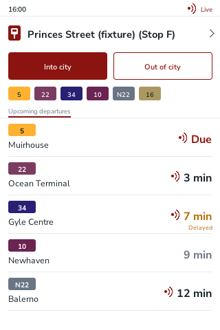
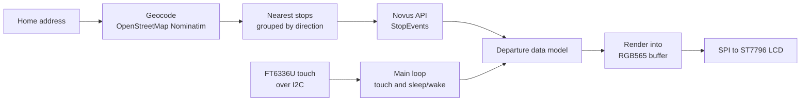

# Lothian Bus Display

A Raspberry Pi bus board: live Lothian departures for the stops nearest your home, on a small touchscreen, written in C++.

<!-- placeholder: replace docs/images/board.png with a real snapshot of the screen -->


## Features

- Finds the bus stops nearest a home address (geocoded with OpenStreetMap Nominatim) and groups them by direction.
- Live departures from the Lothian (Trapeze Novus Open API v1.2) for those stops.
- Touch to pick a stop and choose "into city" or "out of city".
- Route colours match Lothian's own.
- Turns the screen off after 5 minutes idle.

## Hardware

Raspberry Pi 5 with a 3.5" 320 x 480 IPS touchscreen (ST7796S display, FT6336U touch). Full parts list in [docs/hardware.md](docs/hardware.md), pin table in [docs/wiring.md](docs/wiring.md).

## How it works



The main loop in `busTrack.cpp` fetches departures for the current stop, draws them, and handles touch and sleep. The drawing code writes into an RGB565 buffer, which is then sent to the LCD over SPI. The HTTP call (`apiHttp.h`) sends the subscription key in the `Ocp-Apim-Subscription-Key` header.

## Build and install on a Raspberry Pi

1. Enable SPI and I2C: `sudo raspi-config`, then Interface Options.
2. Install the libraries:
   ```sh
   sudo apt install libcurl4-openssl-dev nlohmann-json3-dev
   ```
   The build also needs [wiringPi](http://wiringpi.com/), built from source. It is not in Raspberry Pi OS.
3. Clone and build:
   ```sh
   git clone https://github.com/Hamish-MarshallDawson/Lothian-Api-Bus-Display.git
   cd Lothian-Api-Bus-Display/"C++ files"
   make
   ```
   This builds `busTrack` (the display app) and `openmappull` (a command-line stop finder).
4. Get an API key from the [Trapeze developer portal](https://devportal-public.trapezegroupazure.co.uk/): sign up, subscribe to the product **NRT Open API Edinburgh CEC Bustracker Open Interface**, then copy the Primary key from your Profile page.

## Configuration

- **API key:** set the `BUSTRACKER_KEY` environment variable. Keep it out of the repo and out of logs.
- **Personal settings:** `config.h` (gitignored) holds the things you set for your own board:
  - home address
  - number of stops to show
  - lookahead window and maximum events per stop

## Running as a service

Planned: a systemd unit that starts `busTrack` at boot and restarts it after a crash. It is not in the repo yet.

## Project structure

```
C++ files/        the app: busTrack.cpp (main loop), renderDisplay (drawing),
                  openmappull (geocode and stop search), apiHttp.h, busColours.h,
                  config_utils, Makefile
C/lib/            Waveshare display driver (LCD, touch, paint library, fonts), vendored
docs/             hardware list, wiring table
```

## Development

Planned: a snapshot mode that renders a frame to a PNG, so the UI can be developed without the LCD attached.

## Known issues

From the previous version. Check them again after the rewrite:

- After a long sleep, the stop shown on wake can display a wrong time.
- The screen only wakes from a touch on the dropdown, not from any touch.
- Departure data is not refreshed automatically on wake.

## What I learned

- The Lothian open data API moved from `tfe-opendata.com` to the Trapeze Novus Open API. The old stop-ID lookups no longer work, so the stop search now goes through geocoding and the Novus stop endpoints.
- The API key lives in an environment variable and a gitignored `config.h`, so the repo can be public without it.

## Future ideas

- Show how far away the next bus is, using the vehicle position the API returns.
- An animation of the bus getting closer to the stop.
- Rest hours (for example midnight to 6 am), in place of the idle timeout.
- Weather hints, such as "bring a coat".

## Credits

The display driver and fonts in `C/lib` are Waveshare's and STMicroelectronics' code, copied in as-is. Their licence notices are in the files.

## Licence

Not chosen yet.
