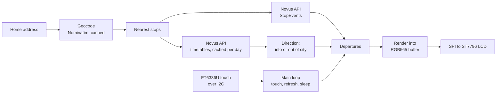

# Lothian Bus Display

A Raspberry Pi bus board: live Lothian departures for the stops nearest your home, on a small touchscreen. Written in C++.

<p align="center">
  
  
  
  
</p>

The screenshots are rendered from hand-made fixtures by the program's snapshot mode, not photographed. The look follows the Lothian Buses app. No Lothian logos or branding are used.

## Features

- Finds the stops nearest a home address (geocoded with OpenStreetMap Nominatim, cached on disk) and groups them into into-city and out-of-city.
- Shows the next departures for the nearest stop, with live times, delays and cancellations from the Lothian Novus Open API v1.2.
- Into and out of city buttons switch direction at once. Direction comes from the operator's timetables, not from a guess about the map.
- Stop list for the current direction. Choose any stop by touch.
- Errors are shown as their own screens (no Wi-Fi, bad key, rate limited, no stops), each with Retry and Choose stop.
- Refresh with back-off: a failed request is retried after 30 s, doubling up to 5 min; a rate limit waits longer. The last good departures stay on screen and are marked with their age.
- Sleeps after 5 minutes with no touch on the board, and wakes on a tap.

## Hardware

Raspberry Pi 5 (16 GB) with a 3.5" 320 x 480 IPS touchscreen (ST7796S display, FT6336U touch). Parts list in [docs/hardware.md](docs/hardware.md). Pin table in [docs/wiring.md](docs/wiring.md).

## How it works



`src/busTrack.cpp` runs the main loop. `refresh.cpp` decides when to fetch and how long to back off. `screens.cpp` holds screen state and touch areas, with no drawing, so it can be tested on its own. `screens_draw.cpp` and `renderDisplay.cpp` draw into a buffer, and the graphics layer in `gfx/` provides anti-aliased text and widgets with baked fonts. The buffer is sent to the LCD over SPI. The HTTP calls (`apiHttp.h`) send the subscription key in the `Ocp-Apim-Subscription-Key` header.

## Build on a Raspberry Pi

1. Enable SPI and I2C: `sudo raspi-config`, then Interface Options.
2. Install the libraries:
   ```sh
   sudo apt install libcurl4-openssl-dev nlohmann-json3-dev zlib1g-dev
   ```
   The display build also needs [wiringPi](http://wiringpi.com/), built from source. It is not in Raspberry Pi OS.
3. Clone and build:
   ```sh
   git clone https://github.com/Hamish-MarshallDawson/Lothian-Api-Bus-Display.git
   cd Lothian-Api-Bus-Display/src
   make
   ```
   Without wiringPi, `make` still builds `busTrack` for snapshot and fetch. It leaves out the display loop.
4. Get an API key from the [Trapeze developer portal](https://devportal-public.trapezegroupazure.co.uk/): sign up, subscribe to the product **NRT Open API Edinburgh CEC Bustracker Open Interface**, then copy the Primary key from your Profile page.

## Configuration

Settings come from environment variables. Nothing personal is compiled in. Copy [`src/config.example.env`](src/config.example.env) to `~/.config/bustracker/env`, fill it in, and run `chmod 600` on it.

| Variable | Required | Meaning |
|----------|----------|---------|
| `BUSTRACKER_KEY` | yes | Novus API subscription key. Never printed or logged. |
| `BUS_ADDRESS` | yes | Home address, used to find the nearest stops. |
| `BUS_NUM_STOPS` | no | Stops offered in each direction (default 8). |
| `BUS_USER_AGENT` | no | HTTP User-Agent. Don't put personal details in it. |

The look-ahead (60 minutes) and the maximum number of departures per stop (12) are fixed in `src/settings.h`.

## Running it

**Snapshot mode** renders one frame to a PNG. It does not touch the GPIO, SPI or touch hardware, so it works with the screen off or absent:

```sh
./busTrack --snapshot out.png --fixture fixtures/stopevents-typical.json --now 2026-10-31T16:00:00 --direction into
./busTrack --snapshot out.png --screen error-no-wifi
```

`--screen` takes `main`, `boot`, `loading`, `direction`, `stop-list`, `error-no-wifi`, `error-key`, `error-rate`, `error-no-stops`, `empty` or `asleep`. `--age SECS` draws the board as if its data were that old. `--fetch <atcocode>` prints one stop's board from the live API.

**Tests** need no network and no display:

```sh
make test
```

They cover the refresh back-off, the direction logic and the parsing of live responses from the fixtures in `src/fixtures/`, plus the screen state machine and touch areas.

**As a service:** [`deploy/bustracker.service`](deploy/bustracker.service) starts `busTrack` at boot and restarts it after a crash. [`deploy/INSTALL.md`](deploy/INSTALL.md) has the steps. The service is written and documented. I have not tested the install on the Pi.

## Project structure

```
src/                 app code: busTrack.cpp (main loop), refresh, departures,
                     timetables, direction, screens, renderDisplay, tests/
src/fixtures/        hand-made and city-centre JSON used by snapshot mode and tests
gfx/                 graphics layer: canvas, text, widgets, baked Nunito fonts
third_party/waveshare/   Waveshare LCD and touch driver, vendored, notices kept
third_party/fonts/   Nunito Sans (OFL) and its notice
third_party/         stb_truetype.h (public domain)
tools/bake_font.cpp  turns the TTF files into the gfx/fonts headers
deploy/              systemd unit and install notes
docs/                hardware, wiring, screenshots
```

## Known issues

- The wake-on-touch and stale-time behaviour from the first version has been rewritten but is not yet checked on the real screen.
- Fonts and screenshots were made with snapshot mode, so text rendering on the LCD itself may differ slightly.

## What I learned

- The Lothian open data API moved from `tfe-opendata.com` to the Trapeze Novus Open API. The old stop-ID lookups no longer work, so the stop search now goes through geocoding and the Novus stop endpoints.
- Keeping the key in an environment variable keeps the repo publishable. Nothing personal is compiled in.
- Snapshot mode and fixtures make the screens checkable without the hardware, and the tests run offline.

## Future ideas

- Show how far away the next bus is, from the vehicle position the API returns.
- An animation of the bus getting closer to the stop.
- Rest hours (for example midnight to 6 am), in addition to the idle timeout.
- Weather hints, such as "bring a coat".

## Credits

- Display and touch driver from Waveshare (`third_party/waveshare`). Their notices are kept in the files.
- [stb_truetype](https://github.com/nothings/stb) by Sean Barrett, public domain. Used by `tools/bake_font.cpp`.
- Nunito Sans by The Nunito Sans Project Authors, under the [SIL Open Font License 1.1](third_party/fonts/OFL-NunitoSans.txt).
- Geocoding by [OpenStreetMap Nominatim](https://nominatim.openstreetmap.org/). Map data © OpenStreetMap contributors.
- Departure, timetable and stop data from Lothian Buses through the Trapeze Novus Open API.

## Licence

The project code is released under the [MIT License](LICENSE). Vendored third-party code in `third_party/` (the Waveshare driver, Nunito Sans, stb_truetype) keeps its own copyright and licence notices, which stay in those files.
