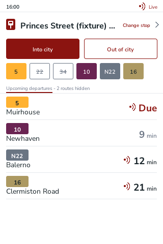
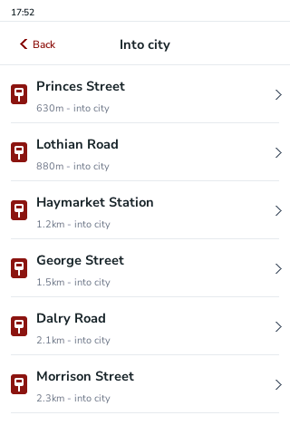
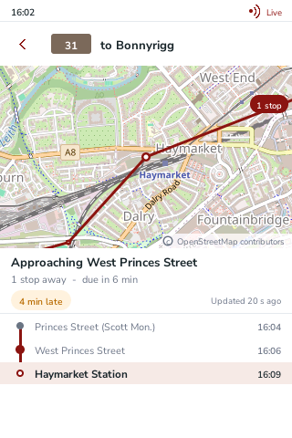
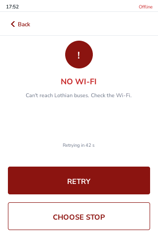
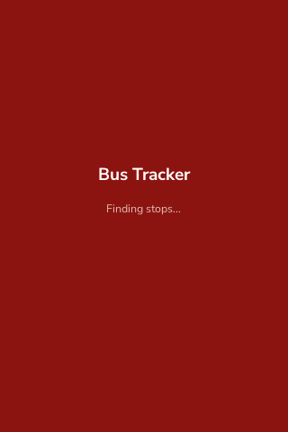
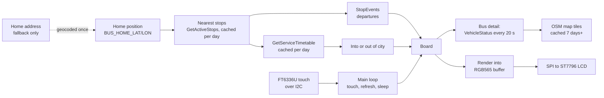

# Lothian Bus Display

A Raspberry Pi bus board: live Lothian departures for the stops near home, on a small touchscreen. Written in C++.

<p align="center">
  
  
  
  
</p>
<p align="center">
  
  
</p>

The screenshots come from the program's snapshot mode, using hand-made or city-centre fixtures, not photographs of a real home. The look follows the Lothian Buses app. No Lothian logos or branding are used.

## Features

- **Board:** the next departures for the nearest stop, with live times, delays and cancellations from the Lothian Novus Open API v1.2.
- **Into and Out of city:** the two buttons switch direction and keep the stop on screen, showing the stop across the road in the other direction. Direction comes from the operator's timetables.
- **Stop list:** every stop for the current direction, with distance. Tap one to show its board.
- **Hide routes:** tap a route chip to hide that route from the board. Hidden routes are saved on the Pi.
- **Bus detail:** tap a departure to see where its bus is on a map, how far away it is, how late it is, and its stops along the route, with the ones already passed marked. The map uses OpenStreetMap tiles. The bus position refreshes every 20 seconds while this screen is open, and nothing is polled from the board.
- **Errors:** no Wi-Fi, a rejected key, rate limiting and no stops each have their own screen, with Retry and Choose stop.
- **Refresh with back-off:** a failed request is retried after 30 s, doubling up to 5 min. A rate limit waits longer. The last good departures stay on screen, marked with their age.
- **Sleep:** the screen turns off after 5 minutes with no touch on the board. A tap wakes it.

## Hardware

Raspberry Pi 5 (16 GB) with a 3.5" 320 x 480 IPS touchscreen (ST7796S display, FT6336U touch). Parts list in [docs/hardware.md](docs/hardware.md). Pin table in [docs/wiring.md](docs/wiring.md).

## How it works



`src/busTrack.cpp` runs the main loop. `refresh.cpp` decides when to fetch and how long to back off. `screens.cpp` holds screen state and touch areas, with no drawing, so it can be tested alone. `screens_draw.cpp`, `bus_detail.cpp` and `renderDisplay.cpp` draw into a buffer. `gfx/` provides anti-aliased text, widgets with baked fonts, and the map panel. The buffer goes to the LCD over SPI. Every HTTP call sends the subscription key in the `Ocp-Apim-Subscription-Key` header and the app's own User-Agent.

## Build on a Raspberry Pi

1. Enable SPI and I2C: `sudo raspi-config`, then Interface Options.
2. Install the libraries:
   ```sh
   sudo apt install libcurl4-openssl-dev nlohmann-json3-dev zlib1g-dev
   ```
   The display build also needs [wiringPi](http://wiringpi.com/), built from source. It is not in Raspberry Pi OS.
3. Clone and build:
   ```sh
   git clone https://github.com/Hamish-MarshallDawson/Lothian-Api-Bus-Display.git
   cd Lothian-Api-Bus-Display/src
   make
   make test
   ```
   Without wiringPi, `make` still builds `busTrack` for snapshot and fetch. It leaves out the display loop.
4. Get an API key from the [Trapeze developer portal](https://devportal-public.trapezegroupazure.co.uk/): sign up, subscribe to the product **NRT Open API Edinburgh CEC Bustracker Open Interface**, then copy the Primary key from your Profile page.

## Configuration

Settings come from environment variables. Nothing personal is compiled in. Copy [`src/config.example.env`](src/config.example.env) to `~/.config/bustracker/env`, fill it in, and run `chmod 600` on it.

| Variable | Required | Meaning |
|----------|----------|---------|
| `BUSTRACKER_KEY` | yes | Novus API subscription key. Never printed or logged. |
| `BUS_HOME_LAT`, `BUS_HOME_LON` | yes, or the address below | Home position in decimal degrees. Preferred. With both set, no geocoder is contacted at all. |
| `BUS_ADDRESS` | fallback | Home address, used only when the position is not set. Geocoded once and cached. It is personal data. |
| `BUS_GEOCODER_URL` | no | Geocoder used with `BUS_ADDRESS`. Default: Nominatim. |
| `BUS_TILE_URL` | no | Map tile URL with `{z}` `{x}` `{y}`. Default: the OpenStreetMap tile server. |
| `BUS_NUM_STOPS` | no | Stops offered in each direction (default 8). |
| `BUS_USER_AGENT` | no | HTTP User-Agent. Default: `LothianBusDisplay/1.0 (+https://github.com/Hamish-MarshallDawson/Lothian-Api-Bus-Display)`. |

The look-ahead (60 minutes) and the maximum number of departures per stop (12) are fixed in `src/settings.h`.

## Data and usage policies

- **Lothian data** comes through the Trapeze Novus Open API. Using it needs your own subscription key, from the developer portal above. The key stays in the settings file.
- **Map tiles** come from OpenStreetMap under its [tile usage policy](https://operations.osmfoundation.org/policies/tiles/). Tiles are cached on disk and revalidated with the server's headers (at least 7 days when there are none). The app sends its own User-Agent, and the map credits OpenStreetMap contributors.
- **Geocoding** is used only when no home position is set. It goes to Nominatim under its [usage policy](https://operations.osmfoundation.org/policies/nominatim/): one request a second at most, the result cached forever, and nothing sent for an hour after a failure.
- Caches live in `~/.cache/bustracker/`: geocoding, stop lists, timetables and directions per day, and map tiles.

## Running it

**Snapshot mode** renders one frame to a PNG. It does not touch the GPIO, SPI or touch hardware, so it works with the screen off or absent:

```sh
./busTrack --snapshot out.png --fixture fixtures/stopevents-typical.json --now 2026-10-31T16:00:00 --direction into
./busTrack --snapshot out.png --fixture fixtures/stopevents-typical.json --now 2026-10-31T16:00:00 --hidden 22,34
./busTrack --snapshot out.png --screen bus-detail-live --tiles ~/.cache/bustracker
```

- `--screen` takes `main`, `boot`, `loading`, `stop-list`, `bus-detail`, `empty`, `asleep`, `error-no-wifi`, `error-key`, `error-rate` or `error-no-stops`. `bus-detail-live`, `bus-detail-stale`, `bus-detail-stuck` and `bus-detail-notstarted` draw the bus detail from a hand-made trip.
- `--fixture` uses a JSON file in place of the live board. `--now` sets the clock for it. `--age SECS` draws the board as if its data were that old.
- `--hidden` takes route names separated by commas. `--direction into|out` sets the highlight.
- `--tiles DIR` gives the map its tiles. Without it, the map draws a plain background.
- `--row N` with `--live-detail STOP` (development only, uses the live API) draws the bus detail for a real departure at a stop.
- `--fetch <atcocode>` prints one stop's board from the live API.

**Tests** need no display and no network:

```sh
make test
```

Five suites: refresh back-off, direction logic, live response parsing, bus tracking, and the screen state machine with its touch areas. They run on fixtures in `src/fixtures/`. `make picker-live` and `make track-live` are development checks against the live API.

**As a service:** [`deploy/bustracker.service`](deploy/bustracker.service) starts `busTrack` at boot and restarts it after a crash. [`deploy/INSTALL.md`](deploy/INSTALL.md) has the steps. The unit is written and documented. I have not installed it on the Pi.

## Project structure

```
src/                       app code: busTrack.cpp (main loop), refresh, departures,
                           timetables, direction, pairing, hidden_routes, tracking,
                           bus_detail, screens, renderDisplay, diskcache, tiles
src/tests/                 the five test suites and two live checks
src/fixtures/              hand-made and city-centre JSON for snapshot mode and tests
gfx/                       graphics: canvas, text, widgets, map panel (gfx/map), baked Nunito fonts
third_party/waveshare/     Waveshare LCD and touch driver, vendored, notices kept
third_party/fonts/         Nunito Sans (OFL) and its notice
third_party/               stb_truetype.h and stb_image.h (public domain)
tools/bake_font.cpp        turns the TTF files into the gfx/fonts headers
deploy/                    systemd unit and install notes
docs/                      hardware, wiring, screenshots
```

## Known issues

- Wake-on-touch and the stale-time behaviour from the first version have been rewritten, but they have not been checked on the real screen.
- The screenshots are rendered by snapshot mode, so text on the LCD itself may differ slightly.

## What I learned

- The Lothian open data API moved from `tfe-opendata.com` to the Trapeze Novus Open API. The old stop-ID lookups no longer work, so stops are found from the stop list by distance.
- Keeping the key and the home position in an environment file keeps the repo publishable. Nothing personal is compiled in.
- Snapshot mode and fixtures make the screens checkable without the hardware, and the tests run offline.

## Future ideas

- Rest hours (for example midnight to 6 am), in addition to the idle timeout.
- Weather hints, such as "bring a coat".
- A short animation of the bus getting closer to the stop.

## Credits

- Display and touch driver from Waveshare (`third_party/waveshare`). Their notices are kept in the files.
- [stb_truetype](https://github.com/nothings/stb) and [stb_image](https://github.com/nothings/stb) by Sean Barrett, public domain. Used for the font baking tool and for reading map tiles.
- Nunito Sans by The Nunito Sans Project Authors, under the [SIL Open Font License 1.1](third_party/fonts/OFL-NunitoSans.txt).
- Map tiles and map data © [OpenStreetMap](https://www.openstreetmap.org/copyright) contributors. Geocoding by [Nominatim](https://nominatim.openstreetmap.org/).
- Departure, timetable, stop and vehicle data from Lothian Buses through the Trapeze Novus Open API.

## Licence

The project code is released under the [MIT License](LICENSE). Vendored third-party code in `third_party/` (the Waveshare driver, Nunito Sans, stb) keeps its own copyright and licence notices, which stay in those files.
